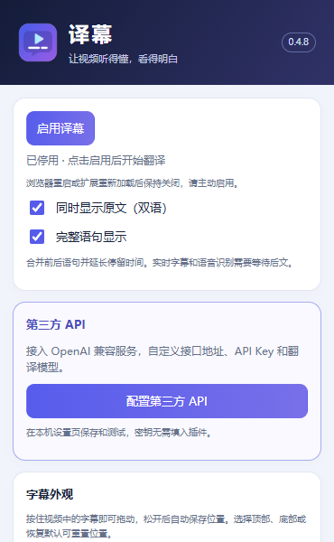

# 0xfaheng · 译幕

**让视频显示中文字幕。** 译幕是 Windows 上的 Chrome / Edge 扩展，配合本机服务，将 YouTube 和按需授权网站的可用字幕翻译为中文或中英双语。

由 [0xfaheng](https://github.com/0xfaheng)（上海封阳科技创始人）维护。微信：`faheng2009` · [微信二维码](https://raw.githubusercontent.com/0xfaheng/0xfaheng/main/assets/wechat-qr.png) · [X](https://x.com/0xfaheng) · [YouTube](https://www.youtube.com/@0xfaheng)。

**当前版本：0.4.8（预览版）** · [下载安装包](https://github.com/0xfaheng/youtube-zh-assistant/releases/tag/v0.4.8) · [完整使用说明](outputs/youtube-zh-assistant/README.md) · [更新记录](outputs/youtube-zh-assistant/CHANGELOG.md)

## 能做什么

- 读取 YouTube 可用字幕，提前批量翻译，按视频时间显示中文或中英双语。
- 合并相邻字幕碎片，支持完整语句显示；可拖拽位置，调整字号、颜色、背景和顶部 / 底部位置。
- 按网站授权读取 HTML5 字幕及部分网页播放器字幕。
- 配置第三方翻译 API 的地址、协议、模型和密钥，保存后测试连接；也支持本机已登录的 Codex CLI 账号方式。
- 没有可读字幕时，手动启用采音与语音识别 Beta。本地识别需要自行部署模型，也可配置云端语音服务。



## 下载与安装

需要 **Windows、Node.js 22+、Chrome / Edge 116+**，以及可用的翻译账号或 API。运行服务无需安装 npm 第三方依赖。

| 下载文件 | 用途 |
| --- | --- |
| [youtube-zh-assistant-v0.4.8.zip](https://github.com/0xfaheng/youtube-zh-assistant/releases/download/v0.4.8/youtube-zh-assistant-v0.4.8.zip) | 首次安装推荐：包含扩展、本机服务、启动脚本及说明 |
| [youtube-zh-assistant-extension-v0.4.8.rar](https://github.com/0xfaheng/youtube-zh-assistant/releases/download/v0.4.8/youtube-zh-assistant-extension-v0.4.8.rar) | 只包含扩展，供已经安装本机服务的用户使用 |
| [SHA256SUMS.txt](https://github.com/0xfaheng/youtube-zh-assistant/releases/download/v0.4.8/SHA256SUMS.txt) | 安装包 SHA-256 校验值 |

1. 下载完整 ZIP，解压后进入 `youtube-zh-assistant` 文件夹，双击 `start.cmd`。
2. 打开 `chrome://extensions`（Edge 为 `edge://extensions`），启用开发者模式，点击“加载已解压的扩展程序”，选择包内 `extension` 文件夹。
3. 在同一个浏览器配置中打开启动器显示的本机设置页，点击“一键配对浏览器插件”，确认“配对已验证”。
4. 配置可用的翻译方式并测试。使用第三方 API 时，填写 Base URL、协议、模型 ID 和 API Key，再点击“保存并测试连接”。
5. 刷新 YouTube 视频页，点击插件图标并选择“启用译幕”，等待首批中文字幕出现。

其他 HTTPS 视频网站需要先在插件中“授权此网站”。停止本机服务可运行 `stop.cmd`。升级前先停止旧服务，更新后在扩展管理页重新加载插件。更多配对、配置和排错步骤见[产品使用说明](outputs/youtube-zh-assistant/README.md)。

在 PowerShell 中可用 `Get-FileHash .\youtube-zh-assistant-v0.4.8.zip -Algorithm SHA256` 对照下载的校验文件。

## 使用边界与隐私

本项目是扩展与本机服务组合，安装包不包含翻译账号、API 密钥、语音模型或 Python 环境。本地语音识别的默认路径来自开发环境，换电脑需要按设置页配置自己的模型及运行环境；仅翻译已有字幕无需部署语音模型。

字幕文本会发送到你选择的翻译服务；只有主动选择云端识别并开始采音时，音频片段才会发送到语音 API。API 测试和翻译可能产生服务商费用。配对码、密钥、运行配置和浏览器资料不包含在仓库或安装包中。

YouTube 主要覆盖桌面普通视频，Shorts、手机 App、DRM / 付费播放器及各网站兼容性未全面验证。语音识别仍为 Beta，延迟取决于模型和网络；约 2 秒采音分片不代表 2 秒内出现译文。0.4.8 的第三方 API 功能已通过本机模拟接口验证，未使用真实第三方服务商账号实测。详细范围见[验证记录](outputs/youtube-zh-assistant/VALIDATION.md)。

## 源码与开发

保留现有开发目录和 Git 历史，正式源码位于 `outputs/youtube-zh-assistant`。

```powershell
git clone https://github.com/0xfaheng/youtube-zh-assistant.git
cd youtube-zh-assistant/outputs/youtube-zh-assistant
npm test
```

扩展代码在 `extension/`，本机服务在 `server/`，设置页在 `web/`。本次公开发布前重新运行了 224 项自动测试，全部通过；既有 0.4.8 包保持原始字节及版本标签。

- [0.4.8 开发记录](outputs/youtube-zh-assistant/开发记录/v0.4.8.md)
- [GitHub 发布记录](docs/GitHub发布-v0.4.8.md)
- [Git 开发、协作与备份](docs/Git开发与并行协作.md)
- [项目开发规则](AGENTS.md)

问题反馈请提交 [Issue](https://github.com/0xfaheng/youtube-zh-assistant/issues)，附版本、浏览器和脱敏后的错误信息。
